<p align="center">
  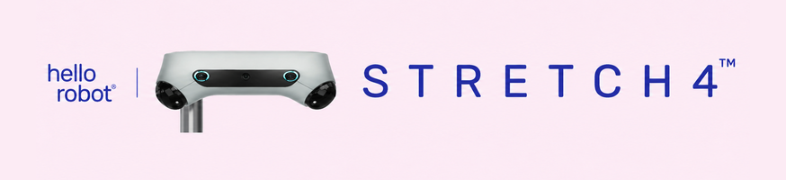
</p>

<h1 align="center">Stretch 4 AI Capabilities</h1>

<p align="center">
  <b>An open-source platform for physical AI.</b><br>
  Frontier models, robot-learning frameworks, and research labs use Hello Robot's Stretch 4 to bring AI into real world tasks.
</p>

<p align="center">
  <a href="https://hello-robot.com"></a>
  
  
</p>

---

Stretch 4 is a 9-dof mobile manipulator. It has an omnidirectional base, a lift, a telescoping arm, a 3-axis wrist, two lidars and three RGB cameras on its head, and a stereo camera on its gripper. Its software is open, so developers can connect almost any model to the robot: a general-purpose LLM agent, a vision-language-action (VLA) policy, or a visuomotor policy trained from demonstrations.

This repository collects some of Stretch 4's AI integrations and open-source AI tools. Each section links to the code, paper, or blog post behind the work.

## At a Glance

| Integration | Institution | Highlight | Code / Paper |
|---|---|---|---|
| [**Stretch x GPT-6 Astra**](#stretch-x-gpt-6-astra) | Georgia Tech RAIL | Zero-shot, long-horizon household tasks across **24** tasks | [Blog](https://www.gt-rail.com/blog/astra-beyond-tabletop/) |
| [**Stretch x VIA**](#stretch-x-via-visual-interface-agent) | Stanford University | **24 / 25** successful real-world trials with no robot-specific fine-tuning | [arXiv:2607.11119](https://arxiv.org/abs/2607.11119) |
| [**Stretch x Robocurve**](#stretch-x-robocurve-multi-robot-agentic-coordination) | Robocurve | Two robots perform a **bimanual** task, driven by Claude Opus 5.5 | [inspect-robots-stretch4](https://github.com/hello-robot/inspect-robots-stretch4) |
| [**Dex Teleop**](#stretch-4-dex-teleop) | Hello Robot | Fast, intuitive whole-arm teleoperation for collecting demonstrations, with one or two robots | [stretch4_dex_teleop](https://github.com/hello-robot/stretch4_dex_teleop) |
| [**Stretch x LeRobot**](#stretch-x-lerobot-hugging-face) | Hugging Face | Pipeline to collect demos, train ACT, Diffusion, or π0.5, and roll out | [stretch4_lerobot](https://github.com/hello-robot/stretch4_lerobot) |
| [**Stretch x MolmoBot**](#stretch-x-molmobot-ai2) | AI2 | Zero-shot cross-embodiment VLA on simulated picks and runs on the real Stretch 4 robot too | [stretch4_mujoco](https://github.com/hello-robot/stretch4_mujoco) |
| [**Grasping Demo**](#stretch-4-grasping-demo) | Hello Robot | Grasp an object from a text description: Molmo 2 + SAM 2 visual servoing | [stretch4_grasping_demo](https://github.com/hello-robot/stretch4_grasping_demo) |
| [**Human Perception**](#stretch-4-human-perception) | Hello Robot | Real-time 2D/3D human pose and segmentation (RTMO, SAM 3.1) | [stretch4_human_perception](https://github.com/hello-robot/stretch4_human_perception) |

## Table of Contents

- [At a Glance](#at-a-glance)
- [Foundation-Model Agents](#foundation-model-agents)
  - [Stretch x GPT-6 Astra](#stretch-x-gpt-6-astra)
  - [Stretch x VIA (Visual Interface Agent)](#stretch-x-via-visual-interface-agent)
  - [Stretch x Robocurve (Multi-Robot Agentic Coordination)](#stretch-x-robocurve-multi-robot-agentic-coordination)
- [Teleoperation and Data Collection](#teleoperation-and-data-collection)
  - [Stretch 4 Dex Teleop](#stretch-4-dex-teleop)
- [Robot Learning and VLAs](#robot-learning-and-vlas)
  - [Stretch x LeRobot (Hugging Face)](#stretch-x-lerobot-hugging-face)
  - [Stretch x MolmoBot (AI2)](#stretch-x-molmobot-ai2)
- [Open-Source Perception and Manipulation](#open-source-perception-and-manipulation)
  - [Stretch 4 Grasping Demo](#stretch-4-grasping-demo)
  - [Stretch 4 Human Perception](#stretch-4-human-perception)
- [Repository Index](#repository-index)
- [Bibliography](#bibliography)
- [Get Stretch 4](#get-stretch-4)

---

# Foundation-Model Agents

General-purpose models that were never trained for robotics, controlling Stretch 4 directly.

## Stretch x GPT-6 Astra

<p>
  
  &nbsp;
  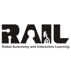
</p>

**Astra enables Stretch 4 to complete long-horizon household tasks.** Prof. Sonia Chernova's team at Georgia Tech's RAIL lab evaluated GPT-6 Astra zero-shot on **24 household tasks** in a mock apartment, with surprisingly strong results [[1]](#ref1).

<p align="center">
  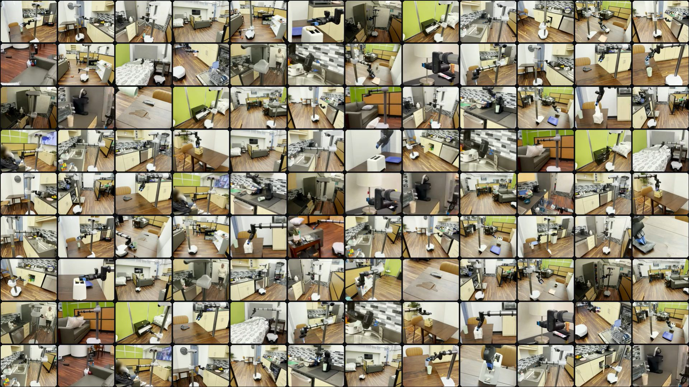
  <br><sub><i>Stretch 4 running GPT-6 Astra in a mock apartment: kitchen, dining, living, play, and bedroom areas.</i></sub>
</p>

**How it works**

- **Zero-shot.** The robot received no training, fine-tuning, demonstrations, or hand-written skills: no grasp planner, navigation stack, or object detector.
- **Observe → reason → execute.** At each turn, the model receives four camera views (gripper, head-center, head-left, head-right), the joint state, and the result of its previous command.
- **Structured actions.** The model returns one JSON object with its reasoning and a single waypoint over 9 joints (`drive`, `slide`, `turn`, `lift`, `arm`, `wrist_swing`, `wrist_tilt`, `wrist_twist`, `grip`). Each value is a displacement from the current pose.
- **Depth on demand.** A `get_gripper_depth` tool returns wrist-camera depth in cm for chosen pixel coordinates.
- **One prompt for every task.** The [system prompt](https://www.gt-rail.com/blog/astra-beyond-tabletop/#system-prompt) has no task-specific hints. The task is appended as `Task: <instruction>`.

Example tasks: *"Make coffee."*, *"Open the dishwasher door."*, *"Toast the bagel."*, *"Clean up the play area."*, *"Find the android phone in the living room."*

> [!NOTE]
> In a 5-trial ablation on a multi-step oven task, *high* reasoning effort did better than *low* and *ultra*. Querying depth through the API did better than passing a color-mapped depth image. The authors name fine-grained manipulation, dependencies across steps, and scene-wide collision awareness as open challenges.

🔗 **[Read the blog post](https://www.gt-rail.com/blog/astra-beyond-tabletop/)** · **[View the system prompt](https://www.gt-rail.com/blog/astra-beyond-tabletop/#system-prompt)**

---

## Stretch x VIA (Visual Interface Agent)

<p>
  
</p>

**VIA enabled Stretch 4 to succeed in 24 of 25 trials across 5 household tasks.** Prof. Dorsa Sadigh and Prof. Jeannette Bohg's team at Stanford developed VIA [[2]](#ref2).

<p align="center">
  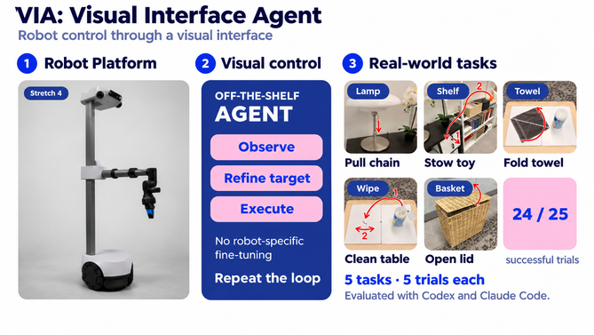
</p>

VIA treats robot control as an **agentic computer-use task**. An off-the-shelf coding agent, such as Claude Code or Codex, drives the manipulator through a visual interface with MCP tools. The agent receives no robot-specific fine-tuning and no extra scaffolding.

| Step | What the agent does |
|---|---|
| **Observe** | Takes screenshots of a virtual workspace that shows the scene and a blue *target* gripper |
| **Refine target** | Moves the target gripper with tools such as `gripper_teleport_via_click`, `gripper_translate`, `gripper_rotate`, and `gripper_toggle`, then checks the rendered result and revises |
| **Execute** | Calls `execute_waypoint` to move the real robot, observes the outcome, and repeats the loop |

**Stretch 4 results** (5 trials per task, randomized starting positions, Codex with Astra 6):

| Lamp: pull chain | Shelf: stow toy | Towel: fold | Wipe: clean table | Basket: open lid | **Total** |
|:---:|:---:|:---:|:---:|:---:|:---:|
| 4/5 | 5/5 | 5/5 | 5/5 | 5/5 | **24/25 (96%)** |

🔗 **[Read the paper (arXiv:2607.11119)](https://arxiv.org/abs/2607.11119)** · **[PDF](https://arxiv.org/pdf/2607.11119)**

---

## Stretch x Robocurve (Multi-Robot Agentic Coordination)

<p>
  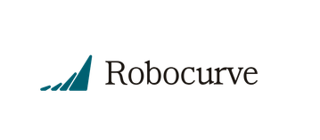
</p>

**Stretch 4 is now integrated with Robocurve's open-source benchmarking framework, [Inspect Robots](https://github.com/robocurve/inspect-robots)** [[3]](#ref3). Two Stretch 4 robots autonomously perform bimanual tasks with frontier models. The images below are from a successful run with **Claude Opus 5.5**.

<p align="center">
  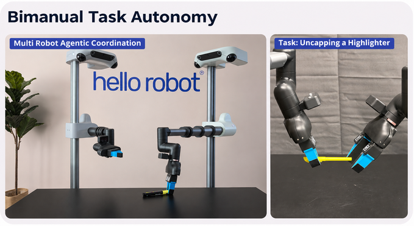
</p>

**Key features**

- **One flag to evaluate any policy.** An LLM agent or a VLA can be evaluated on Stretch 4 with `--embodiment stretch4`. Inspect Robots provides logging, scoring, and [Rerun](https://rerun.io) visualization.
- **Two robots as one.** `--embodiment stretch4-pair` drives two Stretch 4s as a single 12-D or 14-D robot for the bimanual `uncap-marker` task from [StationeryBench](https://openai.robocurve.org/stationerybench/). The robots communicate over a CURVE-encrypted link.
- **No ROS required.** The adapter talks to `stretch_body_server` directly through `stretch4_body`.
- **Safety built in.** Joint targets are clamped to joint limits and step sizes. Pressing either robot's run-stop also stops the other within about 0.2 s, and a lost network link holds both robots.

```bash
# Robot 1: Claude Opus 5.5 drives a two-robot bimanual trial
inspect-robots run --task uncap-marker --policy agent \
    -P model=anthropic/claude-opus-5-5 -P wire=messages -P effort=high \
    --embodiment stretch4-pair -E robot2_host=tcp://<robot 2's IP>:5600 -E base=rotate
```

> [!WARNING]
> This is a **research preview**, and the two-robot setup is experimental. Always supervise the robots and keep a hand on the run-stop.

🔗 **[hello-robot/inspect-robots-stretch4](https://github.com/hello-robot/inspect-robots-stretch4)**

---

# Teleoperation and Data Collection

Robot learning starts with good demonstrations. These tools let people drive Stretch 4 quickly and naturally while recording.

## Stretch 4 Dex Teleop

**Dexterous, whole-arm teleoperation for one or two Stretch 4 robots.** The operator holds modified kitchen tongs with ArUco markers. A webcam on the floor, looking up through a ring light, tracks them. The robot follows in real time, which makes fast, coordinated, multi-joint motions easy to demonstrate.

<table>
  <tr>
    <td align="center"><b>Single-robot teleoperation</b></td>
    <td align="center"><b>Bimanual teleoperation</b></td>
  </tr>
  <tr>
    <td align="center">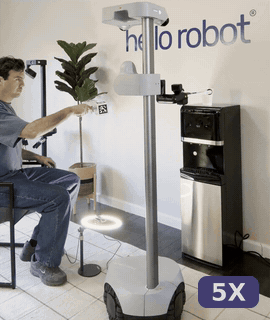</td>
    <td align="center">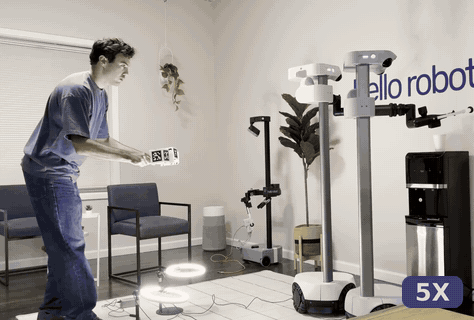</td>
  </tr>
</table>

<p align="center">
  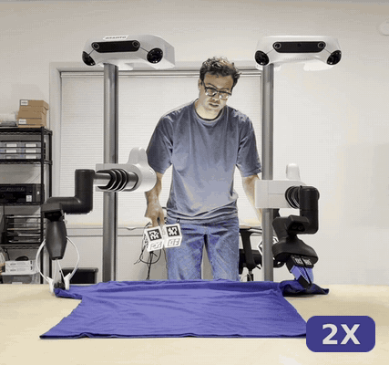
  <br><sub><i>Two Stretch 4 robots folding a shirt with bimanual Dex Teleop.</i></sub>
</p>

**How it works**

- **Pose tracking.** The webcam estimates the tongs' 6-DOF pose and grip width from ArUco markers. The ring light reduces motion blur, so the markers are still detected during fast motions.
- **Arm position.** The position of the tongs sets the end of the telescoping arm through inverse kinematics. The IK models are built from each robot's own calibration.
- **Wrist and gripper.** The tongs' orientation drives the dexterous wrist directly, and their grip width commands the gripper.
- **Interface-agnostic.** Any device that provides a 6-DOF target pose and grip width at 15 Hz or faster can replace the tongs.
- **Bimanual.** Run a second robot with left-hand tongs and the `--left` flag.

| Hardware: camera, ring light, and stand | Hardware: left- and right-hand tongs |
|:---:|:---:|
| 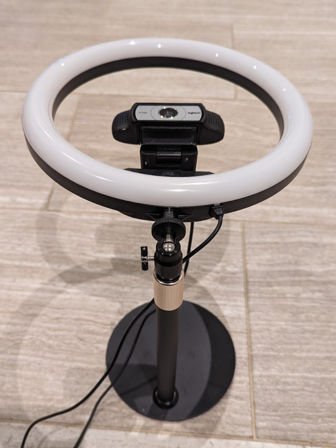 | 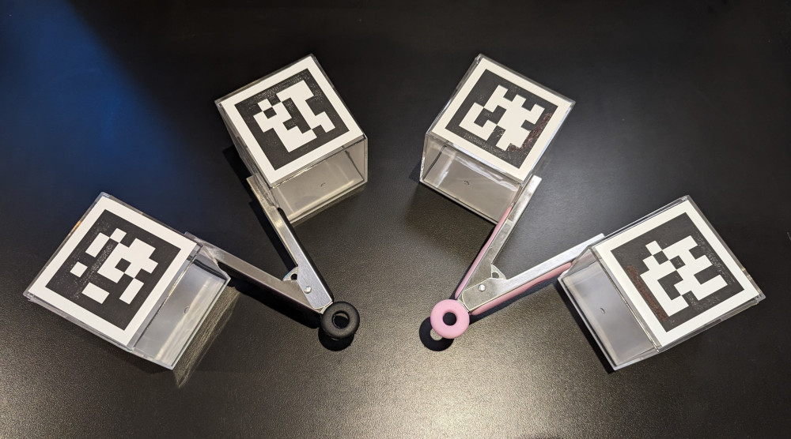 |

```bash
python3 dex_teleop.py              # start at the slowest speed
python3 dex_teleop.py --fast       # faster motion profile once you're comfortable
python3 dex_teleop.py --left       # left-hand tongs for the second robot in a bimanual pair
```

Options include `--ground` for floor-level work, `--slide_lift_range` to reach the full lift height, and a shared-memory multiprocessing mode for better performance. A kit with tongs, a camera, a ring light, and a stand will soon be available from Hello Robot. In the meantime, you can build your own with the [hardware guide](https://docs.google.com/document/d/1Pom3P8vVNRhchLK_CTduoqQJ3y_TS0MYIIAxRl94ktU/edit?usp=sharing).

> [!TIP]
> Dex Teleop is one of the supported data-collection devices for [Stretch x LeRobot](#stretch-x-lerobot-hugging-face). It works especially well for tasks that coordinate wrist rotation with base rotation.

🔗 **[hello-robot/stretch4_dex_teleop](https://github.com/hello-robot/stretch4_dex_teleop)**

---

# Robot Learning and VLAs

Learned policies, both trained on Stretch 4 data and transferred zero-shot from other robots.

## Stretch x LeRobot (Hugging Face)

<p>
  
</p>

**Stretch 4 is now integrated with [LeRobot](https://github.com/huggingface/lerobot) from Hugging Face.** Visuomotor policies trained with data from a range of teleoperation tools let Stretch 4 perform many tasks autonomously [[4]](#ref4).

<p align="center">
  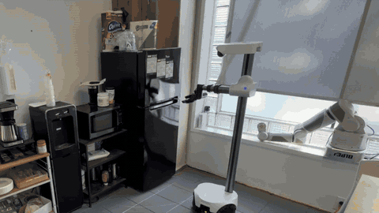
</p>

<p align="center">
  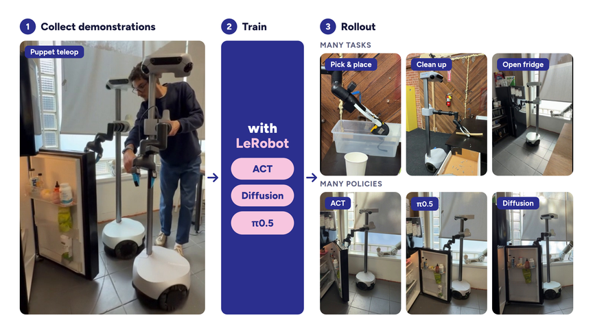
</p>

The integration works with **stock LeRobot commands** (`lerobot-record`, `lerobot-train`, async inference) and requires no changes to LeRobot's code.

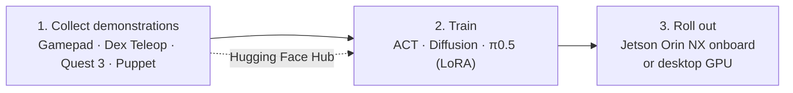

| Policy | `--policy.type` | Tested on Stretch 4 | Runs onboard (Jetson) |
|---|---|:---:|:---:|
| Diffusion | `diffusion` | ✅ | ✅ |
| ACT | `act` | ✅ | ✅ |
| π0.5 (LoRA) | `pi05` | ✅ | Desktop GPU |

**Teleoperation devices for data collection:** gamepad, [Stretch Dex Teleop](#stretch-4-dex-teleop), [Meta Quest 3](https://github.com/hello-robot/stretch4_quest_teleop), and [Puppet Teleop](https://docs.hello-robot.com/stretch4-body-repo/teleoperation/primer_puppet_teleop), where a second robot acts as the controller.

```bash
pip install "lerobot[dataset,training,deepdiff-dep,async]==0.6.*"
pip install -e packages/lerobot_camera_oak \
            -e packages/lerobot_robot_stretch4 \
            -e packages/lerobot_teleoperator_stretch4
```

🔗 **[hello-robot/stretch4_lerobot](https://github.com/hello-robot/stretch4_lerobot)**

---

## Stretch x MolmoBot (AI2)

<p>
  
</p>

**Stretch 4 is now integrated with the [MolmoSpaces](https://github.com/allenai/molmospaces) simulator [[5]](#ref5) and runs AI2's MolmoBot-DROID VLA [[6]](#ref6).** The VLA achieves **zero-shot cross-embodiment** transfer to a simulated Stretch 4.

<p align="center">
  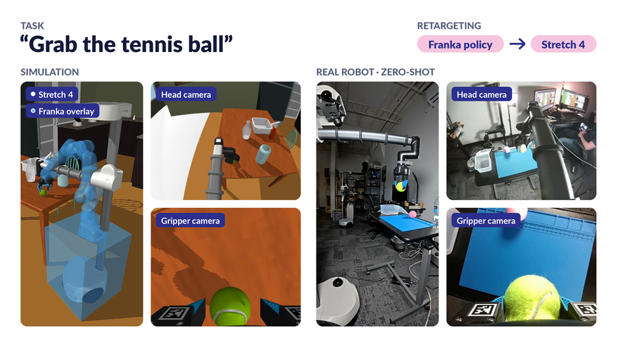
  <br><sub><i>Task: "Grab the tennis ball." A policy trained on a Franka arm is retargeted to Stretch 4, shown in simulation and zero-shot on the real robot.</i></sub>
</p>

The [`stretch4_mujoco`](https://github.com/hello-robot/stretch4_mujoco) simulation stack, built on MuJoCo, provides:

- Calibrated RGB and depth cameras, 2D and 3D lidar, and position and velocity control
- **MolmoSpaces houses** (for example ProcTHOR-10k) and hundreds of **RoboCasa** kitchen variations
- Both Stretch 4 grippers (SG4 and PG4), with working ArUco fingertip tags
- A **digital twin** mode that mirrors motion between the simulator and a real Stretch 4
- A [ROS 2 package](https://github.com/hello-robot/stretch4_ros2/tree/jazzy/stretch_simulation) that works with Nav2

| Standard gripper (SG4), the default | Parallel jaw gripper (PG4) |
|:---:|:---:|
| 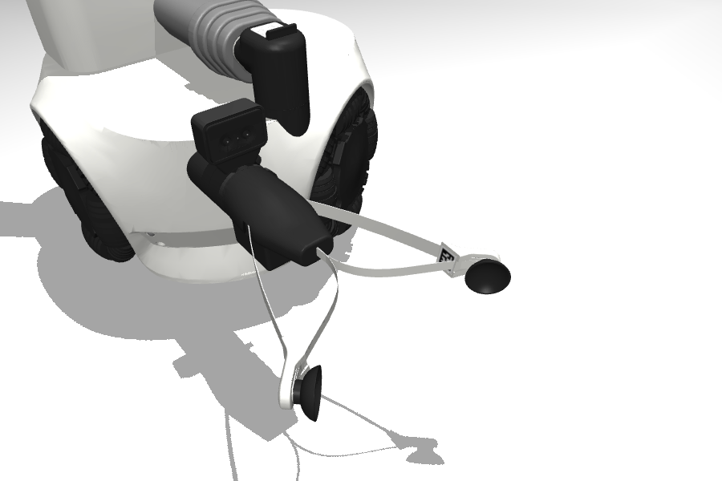 | 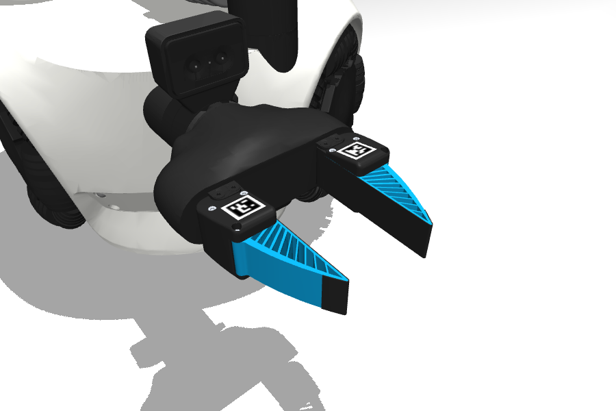 |

```bash
git clone https://github.com/hello-robot/stretch4_mujoco --recurse-submodules && cd stretch4_mujoco
uv venv && uv pip install -e ".[molmo]"        # the molmo extra is Linux-only
uv run python -m examples.molmo_environment --dataset procthor-10k --house-index 0
```

🔗 **[hello-robot/stretch4_mujoco](https://github.com/hello-robot/stretch4_mujoco)**

---

# Open-Source Perception and Manipulation

Ready-to-run building blocks from Hello Robot for language-conditioned grasping and human-aware behavior.

## Stretch 4 Grasping Demo

**Grasp an object described in plain text.** The demo uses the RGB and depth images from Stretch 4's gripper camera and combines a vision-language model, a segmentation model, and closed-loop visual servoing.

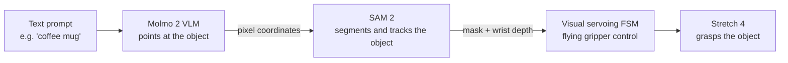

- **[Molmo 2](https://github.com/allenai/molmo2)** turns a description such as *"black rubber rocket with red nozzle"* into a pixel location.
- **[SAM 2](https://github.com/facebookresearch/sam2)** segments the target and keeps tracking it through motion, occlusion, and deformation.
- A **finite state machine** of visual servoing behaviors uses the mask, the wrist depth, and fingertip frame estimates to move the robot. It relies on three [flying gripper](https://github.com/hello-robot/stretch4_flying_gripper) control modes: gripper-frame, gripper-projected-into-base-frame, and direct joint-space.
- Both models load on demand through Hugging Face `transformers`. Perception runs on a remote GPU workstation (tested with an RTX 5090) over a fast Wi-Fi link.

```bash
# Desktop: test perception, then run closed-loop grasping
python3 recv_and_molmo_sam2_gripper_images.py --remote "coffee mug"
python3 grasping_demo.py --remote "coffee mug"
```

> [!WARNING]
> The demo does not avoid obstacles. Clear the scene before you run it, and be ready to press the run-stop.

🔗 **[hello-robot/stretch4_grasping_demo](https://github.com/hello-robot/stretch4_grasping_demo)**

---

## Stretch 4 Human Perception

**Real-time human pose estimation and segmentation for human-aware robot behavior**, running on the robot or on a remote desktop.

| Capability | Model / Tooling | Runs on |
|---|---|---|
| 2D multi-person pose estimation | **RTMO** via **OpenVINO** (CPU / GPU / NPU) | Robot (edge) |
| 3D pose from RGB-D, visualized with the point cloud | RTMO + RGB-D + lidar, visualized in **ReRun** | Robot (edge) |
| Person segmentation and 3D body point clouds | **SAM 3.1** | Desktop GPU |
| Body, hand, and face keypoints | **MediaPipe** (body / hands / face / holistic) | Desktop |
| Robot self-model in the point cloud | **Pinocchio** forward kinematics + RGB-D | Robot or desktop |

**Interactive demos**

- 🚶 **Follow a person.** The omnidirectional base follows a human around the room.
- 🤜 **Fist bump.** The robot tracks a person's hand and returns a fist bump when the hand moves up and toward it.

```python
import cv2
from stretch4_human_pose_estimation import RTMOPipeline

pipeline = RTMOPipeline(size='m', device='AUTO')      # CPU / GPU / NPU via OpenVINO
image = cv2.imread('test_image.jpg')
results = pipeline.predict(image, conf_threshold=0.5)
cv2.imshow("RTMO", pipeline.visualize(image, results))
cv2.waitKey(0)
```

🔗 **[hello-robot/stretch4_human_perception](https://github.com/hello-robot/stretch4_human_perception)**

---

# Repository Index

| Repository | Description |
|---|---|
| [stretch4_dex_teleop](https://github.com/hello-robot/stretch4_dex_teleop) | Dexterous teleoperation with tracked tongs, for one or two robots |
| [stretch4_lerobot](https://github.com/hello-robot/stretch4_lerobot) | LeRobot robot, camera, and teleoperator plugins, plus a policy server and rollout tools |
| [inspect-robots-stretch4](https://github.com/hello-robot/inspect-robots-stretch4) | Inspect Robots embodiment adapter for one or two Stretch 4s |
| [stretch4_mujoco](https://github.com/hello-robot/stretch4_mujoco) | MuJoCo simulation with MolmoSpaces and RoboCasa scenes and a digital twin |
| [stretch4_grasping_demo](https://github.com/hello-robot/stretch4_grasping_demo) | Text-prompted grasping with Molmo 2, SAM 2, and visual servoing |
| [stretch4_human_perception](https://github.com/hello-robot/stretch4_human_perception) | Human pose estimation (RTMO, OpenVINO) and segmentation (SAM 3.1) |

# Bibliography

<a id="ref1"></a>**[1]** Y. Zheng et al., "Astra Beyond Tabletop: Into the Home," Georgia Institute of Technology, 2026. [[blog]](https://www.gt-rail.com/blog/astra-beyond-tabletop/)

<a id="ref2"></a>**[2]** H. Hu et al., "VIA: Visual Interface Agent for Robot Control," arXiv:2607.11119, 2026. [[arXiv]](https://arxiv.org/abs/2607.11119)

<a id="ref3"></a>**[3]** S. Machcha et al., "Opus 5.5 on RoboDojo-RC Tier 1: Higher Scores at Lower Cost," Robocurve, Sept. 23, 2026.

<a id="ref4"></a>**[4]** F. Capuano et al., "Robot Learning: A Tutorial," Hugging Face, 2026.

<a id="ref5"></a>**[5]** Y. Kim et al., "MolmoSpaces: A Large-Scale Open Ecosystem for Robot Navigation and Manipulation," arXiv:2602.11337, 2026. [[arXiv]](https://arxiv.org/abs/2602.11337)

<a id="ref6"></a>**[6]** A. Deshpande et al., "MolmoBot: Large-Scale Simulation Enables Zero-Shot Manipulation," CoRL, 2026.

---

# Get Stretch 4

<p align="center">
  <b>Bring your ideas into the real world.</b><br>
  <i>Made for developers, by developers.</i>
</p>

<p align="center">
  <a href="https://hello-robot.com"><b>hello-robot.com</b></a><br>
  Available now: <b>$29,950</b><br>
  <sub>Ships within 2 weeks of the purchase date.</sub>
</p>
